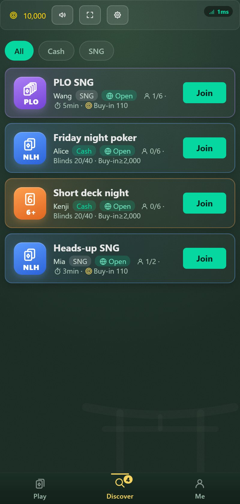
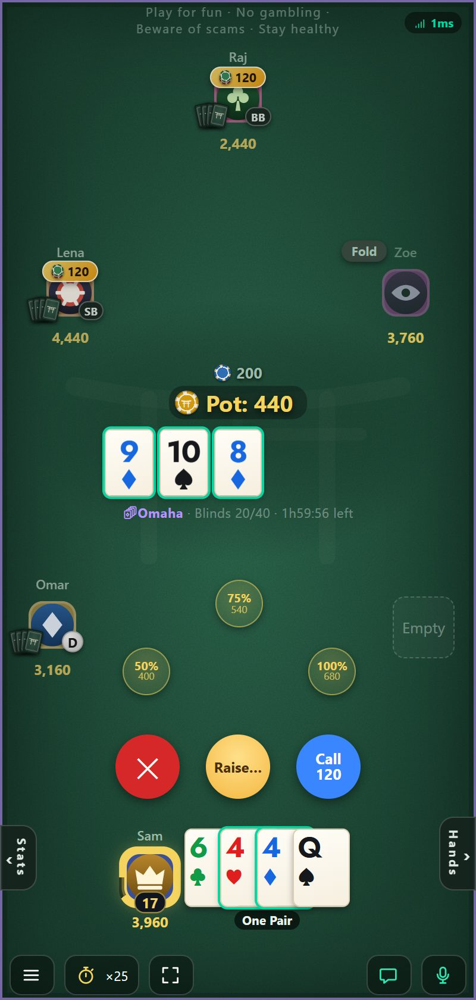
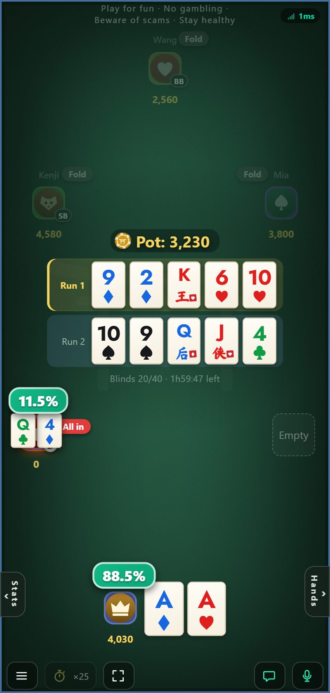
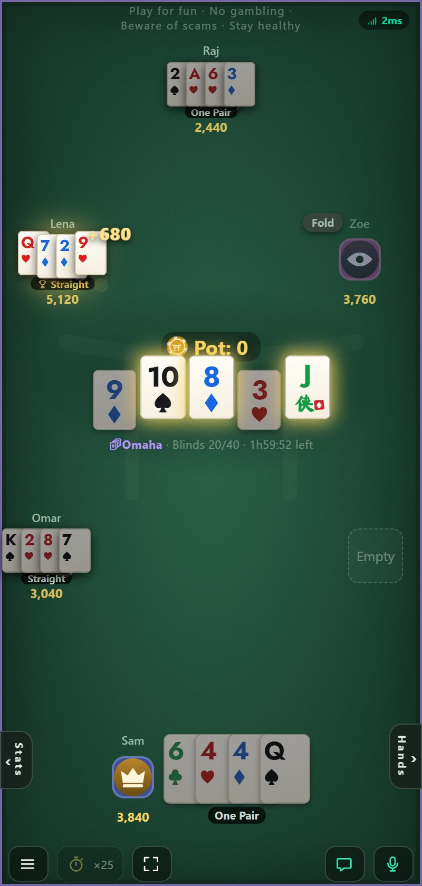
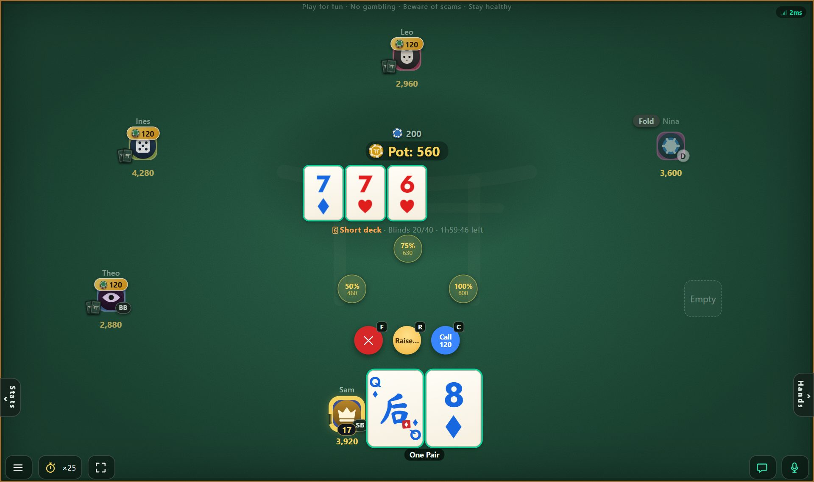

<p align="right"><a href="./README.zh-CN.md">中文</a> | <b>English</b></p>

# 🀄 Poker Dojo (德扑道场)

> Open a private room, play Hold'em, Short Deck or Omaha with friends, and grow together.

Poker Dojo is a **server-authoritative** online poker game built for playing with friends — Texas Hold'em, Short Deck (6+) and Pot-Limit Omaha. All game logic (shuffling, dealing, hand evaluation, betting, settlement) runs on the server; clients only render and send actions. It ships with a lobby, SNG tournaments, cash "training" tables, a full multiplayer engine (real side pots, run-it-N-times), hand histories with shareable replay links, career stats, guest play, chat/emote/voice, and a Capacitor Android shell.

> **Responsible play:** This is a **play-money** game for friends to practice and have fun. It is **not gambling** — no real-money wagering, cash-out, or prizes. Green competition, stay away from gambling.

> 📝 **Essay — [The Difference Is Knowing Why](docs/essay.md)** ([中文](docs/essay.zh-CN.md)): notes from years at the poker table — most of them not about poker — and why I built Poker Dojo.

---

## 📸 Screenshots

| Lobby | Omaha table | Run it twice | Omaha showdown |
|:---:|:---:|:---:|:---:|
|  |  |  |  |



<sub>Captured from a local server with test accounts — all names are fictional. 中文界面截图见 [README.zh-CN.md](./README.zh-CN.md).</sub>

---

## ✨ Features

- **Server-authoritative engine** — hole cards are private (`io.to(socketId)`), broadcasts carry only public info, every action is validated server-side. You cannot cheat by inspecting your own traffic.
- **Provably fair dealing** — fresh deck every hand, Fisher–Yates, unbiased and unpredictable. Every hand is **committed to before the deal and revealed after**, so anyone can recompute the deck offline and check it was never changed mid-hand ([how to verify](#-provably-fair)).
- **Three games** — pick one when you create a room; each has its own colour and icon in the lobby.
  - **Texas Hold'em** (no-limit).
  - **Short Deck / 6+ Hold'em** — 36 cards (2–5 removed); a flush beats a full house, a straight beats three of a kind, and A-6-7-8-9 is a straight.
  - **Pot-Limit Omaha** — four hole cards; you must use exactly two of them plus three from the board; bets are capped at the pot.

  Hand histories, career stats, all-in equity, the provably-fair verifier and the hand-rankings guide all follow the game being played.
- **Two room types** (available for every game)
  - **SNG** (Sit-N-Go single-table tournament): increasing blinds, elimination; the prize pool (after rake) is paid by place — winner-take-all heads-up, top 2 for 3–6 players, top 3 for 7–9.
  - **Cash / "Training" table** (2–9 players): fixed blinds, buy-in/cash-out at a gold↔chips rate, training duration + extensions.
- **Full multiplayer engine** — proper action order (UTG first), button rotation, and **real side pots** (with adjacent-pot merging + uncalled-bet return).
- **Home-game rules** — 7-2 bounty, bomb pots (every N hands, or "next hand"), chained straddles. Changing the blinds, the 7-2 bounty or bomb-pot settings mid-session needs **every seated player to agree**, and takes effect from the next hand.
- **Run it N times** — when two players are all-in, the underdog picks how many times to run (1–5) and the leader agrees; the pot is split into N shares, each dealt street-by-street on the table.
- **Hand histories = data asset** — every hand (per-street actions, think time, hole cards, board, result, timestamp) is archived per player and per game mode in SQLite. Each hand also keeps its full original record verbatim, so nothing is lost to schema changes.
- **Replay & share** — any hand can be replayed on an animated table, and shared as a public link. The link only shows what the sharer could see at the time (folded cards stay hidden) and never exposes account names or seeds.
- **Career stats** — VPIP / PFR / 3-bet / C-bet / AF / WTSD / net + profit curve, aggregated from hand histories.
- **Table UX** — ring seating, avatars, breathing action timer + ring countdown, bet slider + phone number pad, pre-actions, all-in equity %, slow-reveal run-outs, chip/pot animations, haptics. Four card styles (four-color / classic / black / big-index) and two face-card art sets (calligraphy seals / dojo warriors). Desktop scales up to the screen and shows keyboard shortcuts on the buttons.
- **Host tools** — private rooms joined by 4-digit code or invite link, entry lock, choice of think time, optional buy-in approval, pause dealing, move a player to the rail, "play again" after an SNG.
- **Social** — in-table chat + quick phrases, tap-avatar emotes, push-to-talk voice bubbles.
- **Accounts & security** — play instantly as a guest with just a nickname (an invite link drops you straight at the table) and save it as a full account later without losing chips or history; username/email registration with email verification codes, JWT auth (per-server random signing key), TLS/WSS in production.
- **New-player friendly** — a hand-rankings cheat sheet for each game (Short Deck marks the rows that differ from Hold'em; Omaha shows the three hands people misread most), a rules card the first time you sit at a Short Deck or Omaha table, a three-step hint the first time you are dealt in, and a sample hand to watch before anyone else is online.
- **Android** — a thin **Capacitor** shell points at the live site; the game updates by deploying the server, no re-release needed.

---

## 🔒 Provably fair

The shuffle was always unbiased — a fresh deck every hand, Fisher–Yates, seeded from a CSPRNG.
But you had no way to **check** that; you had to take our word for it.
Now every hand is committed to *before* it is dealt and revealed after, so you can verify it yourself, offline.

### How it works

1. **Before any card is dealt**, the server publishes `commit = SHA256(serverSeed)` to the whole table.
2. The entire deck order is derived deterministically from `(serverSeed, clientSeed, nonce)`.
   There is no other source of randomness.
3. **When the whole table ends**, the server publishes `serverSeed` together with the full deck
   order, and you can pull it from your hand history.

   Why the table and not each hand: revealing the seed reveals the *entire* deck — including cards
   other players folded and never showed. Publishing that between hands would hand everyone at the
   table a free HUD. Waiting until the table breaks up costs you nothing: the commitment was already
   public before the deal, so it is just as verifiable later.

Because the commitment is published *before* the deal, the server cannot change the deck after
seeing anyone's cards — a different deck would no longer match the commitment everyone already holds.

### Verify a hand yourself

1. **After the table has ended**, in the app: **Hand history → open a hand → 🔒 Verify data**,
   which copies the full hand record as JSON. Save it as `hand.json`.
   (While a table is still running the seed is withheld, and the button tells you so.)
   (The current hand's commitment is visible any time under **table menu ☰ → 🔒 Fairness**.)
2. Run:

```bash
node PokerServer/tools/verify-hand.js hand.json

# output is Chinese by default; add --en for English
node PokerServer/tools/verify-hand.js hand.json --en
```

It checks three things:

| # | Check | Why it matters |
|---|---|---|
| 1 | `SHA256(revealed seed)` equals the commitment published before the deal | the server was locked in before it saw a single card |
| 2 | Re-shuffling with the revealed seed reproduces the recorded deck order | that order really did come from that seed |
| 3 | That deck order explains the hole cards and board you actually saw | this is the deck that was dealt to **you** |

The verifier never contacts the server and uses nothing but standard SHA-256. The whole scheme is a
few dozen lines (`PokerServer/src/games/poker/provably-fair.js`) — reimplement it in any language
and you should get the same answer.

Want to confirm the checker isn't just rubber-stamping? Edit one card in `community` and run it
again — it fails.

### What this proves, and what it doesn't

- ✅ **It proves** the server cannot alter the deck after seeing any player's cards.
  That is the thing players actually worry about.
- ⚠️ **It does not prove** that the server didn't grind many seeds *before* committing in order to
  pick a favourable one. Defending against that requires the player to choose `clientSeed` **after**
  seeing the commitment. The commitment is already published one hand in advance, so the hook is
  there — but a player-supplied `clientSeed` is not built yet; today it is simply the room number.

> One implementation note, since it is the easiest way to get this wrong: the seeded RNG uses
> **rejection sampling**, not `byte % n`. Plain modulo would bias the deck toward the first few
> cards. At 32 bits that bias is ~1e-8 — far too small for any statistical test to catch, which is
> exactly why it has to be handled structurally rather than "tested for".

---

## 🧱 Architecture

```
Browser / Android (thin client)  ──socket.io──►  Node server (authoritative)
   render + input only                              shuffle · deal · evaluate
                                                     bet · side pots · settle
                                                     hand history (SQLite)
```

- **Server authority:** all rules on the server; clients never receive opponents' hole cards.
- **Hand evaluation:** Cactus Kev + Paul Senzee perfect-hash. Each card is a 32-bit int; 7-card hands enumerate C(7,5); score 1 (best) … 7462 (worst). JS port uses `>>> 0` for unsigned 32-bit math.
- **Game variants:** everything that differs between games (deck, number of hole cards, hand evaluation, bet cap) lives in `PokerServer/src/games/poker/variants/`. Short Deck re-ranks the 5-card score into its own category order; Omaha takes the best of two-from-hand × three-from-board. Hold'em behaviour is pinned by a golden-fixture suite (`PokerServer/golden/`) that must stay byte-identical.
- **Storage:** SQLite is the durable source of truth for users, wallet transactions, hand histories, and active-match snapshots. Memory remains the real-time working state; unfinished matches are restored after restart.

### Project structure

| Path | What |
|------|------|
| `PokerServer/` | Node.js game server (Express + Socket.IO) and the single-page client (`index.html`) |
| `PokerLogic/`  | C# reference prototype of the hand evaluator (algorithm origin; JS is authoritative) |
| `mobile/`      | Capacitor Android shell (`capacitor.config.json` points at the live URL) |
| `docs/`        | Design notes |

**Tech:** Node.js · Express · Socket.IO · vanilla HTML/CSS/JS client · JWT · bcrypt · nodemailer · SQLite (better-sqlite3, WAL).

---

## 🚀 Quick start (local dev)

```bash
cd PokerServer
npm install
LOCAL_DEV=1 PORT=3000 node server.js
# open http://127.0.0.1:3000
```

`LOCAL_DEV=1` binds to localhost and seeds two throwaway accounts (`test`/`test`, `test2`/`test2`) so you can log in immediately. Email sending falls back to printing verification codes to the server log when SMTP isn't configured.

> Production deployment (server provisioning, TLS, backups) is intentionally kept out of this README.

---

## 🤝 Contributing

Issues and PRs are welcome — this project is public so friends can help improve it. Please read [`CONTRIBUTING.md`](./CONTRIBUTING.md) first. The **JS server (`PokerServer/`) is the source of truth**; the C# code is a reference prototype only.

Release history is in [`CHANGELOG.md`](./CHANGELOG.md); older development notes are in [`docs/archive/`](./docs/archive/).

Found a security issue (auth, hole-card leakage, economy exploit)? Please follow [`SECURITY.md`](./SECURITY.md) and report privately.

---

## 📄 License & branding

This project is licensed under the **[PolyForm Noncommercial License 1.0.0](./LICENSE)**. The source is **public and open to contributions**, and you may use, self-host, and modify it **for any noncommercial purpose**. **Any commercial use requires the author's written permission** — please reach out to arrange a commercial license.

The product name **"Poker Dojo / 德扑道场"** and its logo are **not** covered by the code license — please don't use the name or branding for your own product, even if your use of the code is permitted.

**Third-party assets** (their own licenses, shipped alongside them):
- Card-rank font: [Jost](https://github.com/indestructible-type/Jost) subset — SIL Open Font License 1.1 (`PokerServer/public/fonts/Jost-OFL.txt`)
- Face-card calligraphy (侠 / 后 / 王): [Ma Shan Zheng](https://github.com/googlefonts/mashanzheng) subset — SIL Open Font License 1.1 (`PokerServer/public/fonts/MaShanZheng-OFL.txt`)
- Card and chip sounds: [Kenney — Casino Audio](https://kenney.nl/assets/casino-audio) — CC0 (`PokerServer/public/sfx/Kenney-Casino-Audio-License.txt`)

© Poker Dojo. All rights reserved except as granted by the LICENSE.
